# Sistema de Recomendação de Livros

Trabalho final (Avaliação 3) da matéria Desenvolvimento de Sistemas de IA.

Sistema de recomendação de livros com API em FastAPI e containerização com Docker, usando a base **Book Genome** da GroupLens.

* Base de dados: https://grouplens.org/datasets/book-genome/
* Licença da base: Creative Commons Attribution-NonCommercial 3.0

#####

## Divisão do trabalho

* 1 - Escolha do conjunto de dados: João Pedro Pinheiro Ghesti
* 2 - Desenvolvimento do modelo de recomendação: Eduardo Henrique Moraes Santos
* 3 - Criação da API com FastAPI: Eduardo Henrique Moraes Santos
* 4 - Containerização com Docker: Thiago Castro Barreto
* 5 - Documentação (este README): todo o grupo
* 5 - Testes unitários e de integração: João Pedro Pinheiro Ghesti

#####

## Versões usadas

* **Python 3.14** (testado com o 3.14.7 no Windows)
* Bibliotecas, com as versões exatas no `requirements.txt`:
  * pandas 3.1.1
  * numpy 2.5.5
  * scikit-learn 1.9.1
  * scipy 1.18.1
  * fastapi 0.165.0
  * uvicorn 0.54.0
* Banco de dados: SQLite, que já vem com o Python (não precisa instalar nada)
* Só para os testes, com as versões exatas no `requirements-dev.txt` (não entram na imagem do Docker):
  * pytest 9.2.0
  * pytest-cov 7.1.0
  * httpx2 2.16.2 (usado pelo `TestClient` do FastAPI)

Use a mesma versão do Python em todos os computadores, para evitar diferenças.

#####

## Requisitos do computador

* Cerca de 3 GB livres no disco, só durante o download da base. Depois de pronto, a pasta `data/` ocupa uns 800 MB.
* 8 GB de RAM são suficientes. O passo mais pesado (tratamento dos dados) usa cerca de 1 GB, e a API ligada usa cerca de 300 MB.
* Internet, só para baixar a base na primeira vez.
* Para rodar com Docker (recomendado): **Docker Desktop** instalado e aberto. Não precisa instalar Python nem as bibliotecas.

#####

## Como executar com Docker (recomendado)

Com o Docker, o projeto inteiro roda com **um único comando**: ele baixa a base, trata os dados, treina o modelo,
cria o banco e liga a API. Não é preciso instalar Python, criar o ambiente virtual nem rodar os scripts um por um.
(Testado no Windows com Docker Desktop.)

#### Passo a passo

1. Instale o **Docker Desktop**, abra e espere a mensagem *Engine running*. Para conferir, rode no terminal:

   ```
   docker compose version
   ```

2. Baixe o projeto:

   ```
   git clone https://github.com/EduardHenriqueCEUB/Avaliacao3.git
   cd Avaliacao3
   ```

3. Suba tudo:

   ```
   docker compose up --build
   ```

   Na **primeira vez** leva alguns minutos, principalmente pelo download da base (1,4 GB). Nas próximas vezes, os passos
   já feitos são pulados e a API liga em segundos.

4. Quando aparecer `Application startup complete.`, abra no navegador:

   ```
   http://localhost:8000/docs
   ```

5. Para desligar, aperte `Ctrl + C` (ou use `docker compose down` em outro terminal). Os dados são mantidos.
   Para apagar **tudo** e recomeçar do zero: `docker compose down -v`.

Mais detalhes, comandos úteis e problemas comuns estão no arquivo [DOCKER.md](DOCKER.md).

#### Como funciona

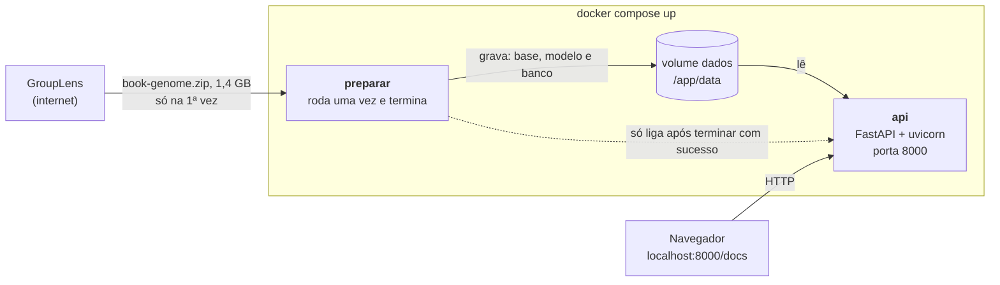

* **`preparar`** executa os passos 3 a 7 da seção [Como executar sem Docker](#como-executar-sem-docker-manual),
  um depois do outro, e termina. O que já foi feito é pulado.
* **`api`** só liga depois que o `preparar` termina com sucesso, porque a API se recusa a ligar sem o modelo e o banco.
* Os dados ficam num **volume do Docker** (`/app/data`). Ele sobrevive a `docker compose down`, então os usuários criados
  pela API não se perdem quando o container é desligado.
* A base de dados **não entra na imagem** (são 1,4 GB): ela é baixada uma vez, para o volume.

| Arquivo | Para que serve |
|---|---|
| `Dockerfile` | receita da imagem (Python 3.14 + bibliotecas + código) |
| `docker-compose.yml` | define os dois serviços (`preparar` e `api`) e o volume de dados |
| `docker/preparar.py` | roda os passos de preparação e confere se cada um realmente terminou |
| `docker-compose.local-data.yml` | opcional: usa a pasta `data/` do computador em vez do volume |
| `.dockerignore` | o que não entra na imagem (principalmente a pasta `data/`) |

#### Roteiro de teste no Swagger

Com a API no ar em `http://localhost:8000/docs`, use os endpoints nesta ordem (clique em *Try it out* e depois em *Execute*):

1. `GET /livros/busca`: procure um livro pelo título (por exemplo, `harry potter`) e anote o `livro_id`.
2. `POST /usuarios`: crie um usuário com algumas avaliações (use `livro_id`s da busca) e anote o `usuario_id`.
3. `GET /usuarios/{usuario_id}/recomendacoes`: veja a lista de livros recomendados e o motivo de cada um.
4. `GET /usuarios/{usuario_id}`: depois de `docker compose down` e `docker compose up`, o usuário continua lá.

#####

## Evidências de funcionamento

Os prints abaixo mostram que o Docker está instalado, como o projeto sobe em container e o sistema funcionando.

### 1. O Docker está instalado e o projeto tem os arquivos de container

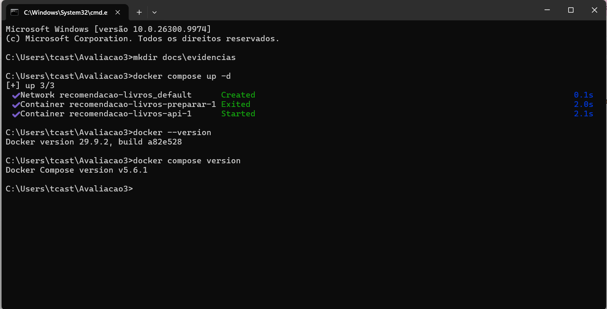

*Docker e Docker Compose instalados na máquina.*

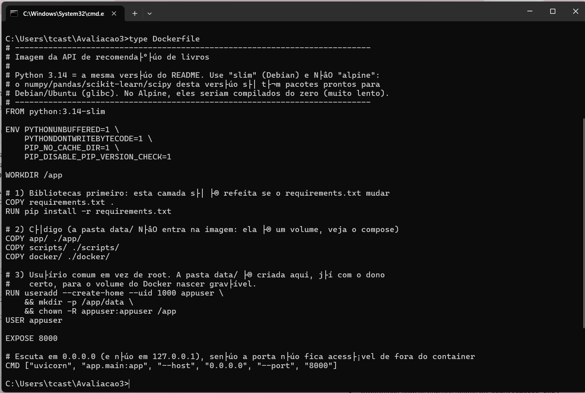

*O `Dockerfile` do projeto.*

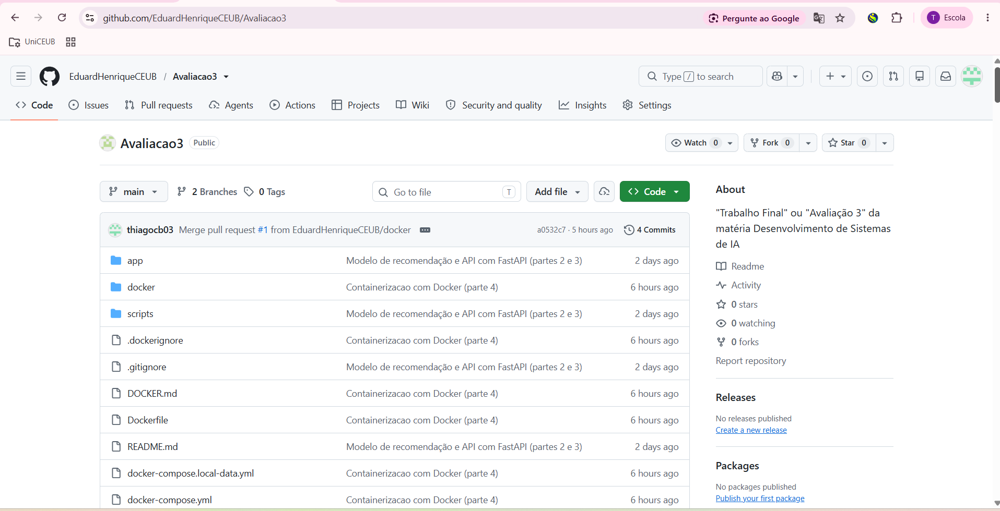

*Os arquivos de containerização no repositório.*

### 2. Como funciona: preparação e containers

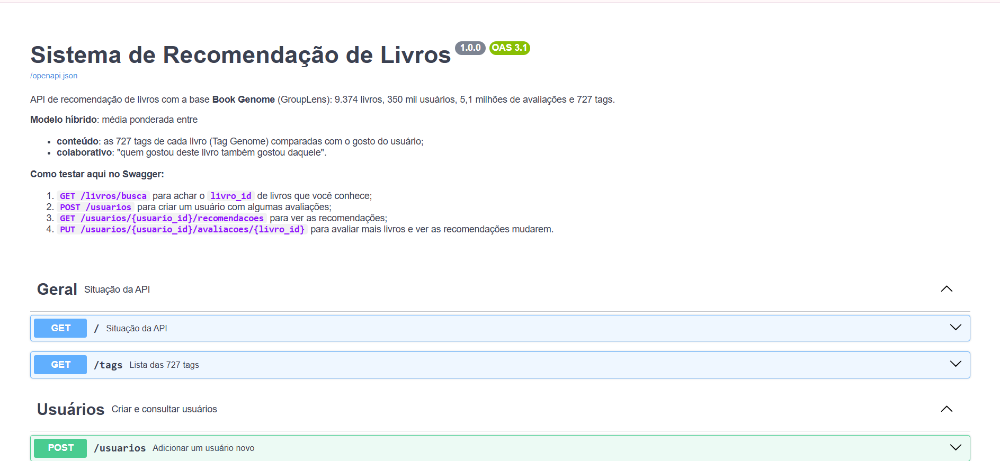

*Primeira execução: o serviço `preparar` conclui as 4 etapas (base com 350.332 usuários e 5.152.656 avaliações) e a API liga.*

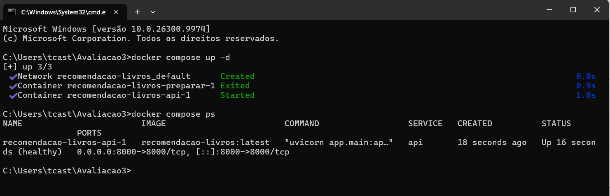

*`docker compose ps`: a API aparece como `healthy`.*

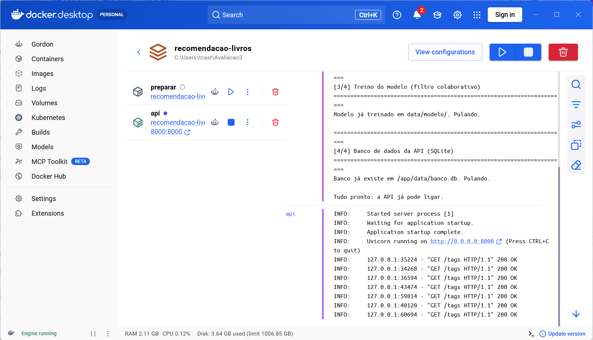

*Os containers no Docker Desktop: `api` em execução e `preparar` já finalizado.*

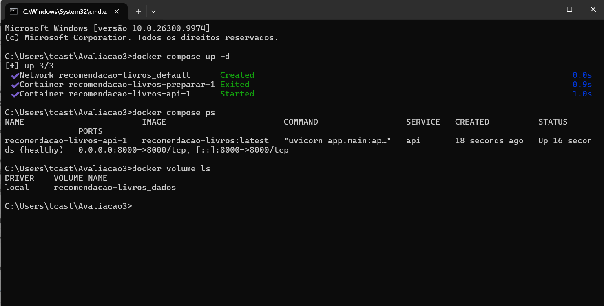

*O volume `dados`, onde ficam a base, o modelo e o banco.*

### 3. O sistema rodando

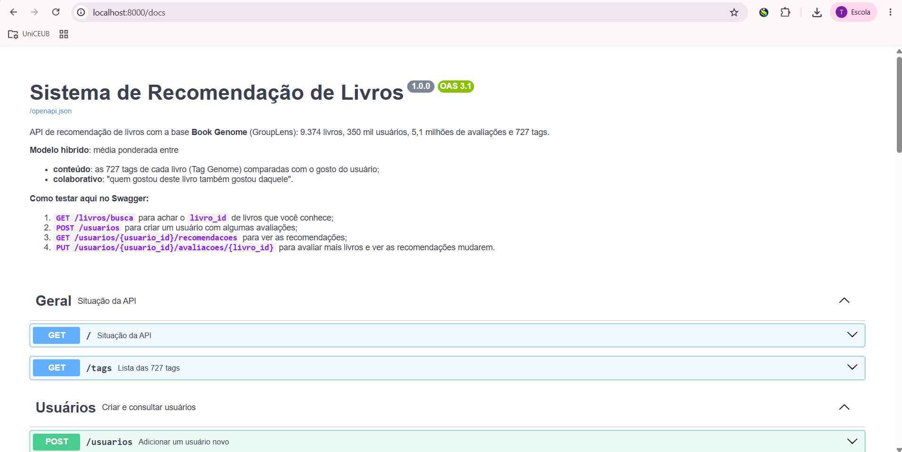

*A API no ar em `http://localhost:8000/docs`.*

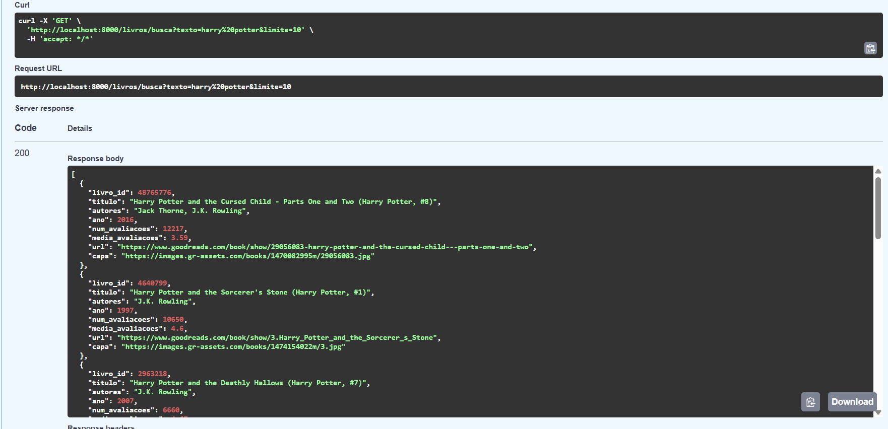

*`GET /livros/busca`: busca de livros por título.*

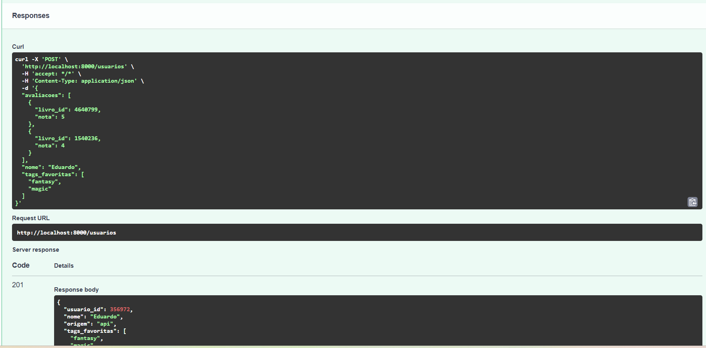

*`POST /usuarios`: criação de um usuário novo.*

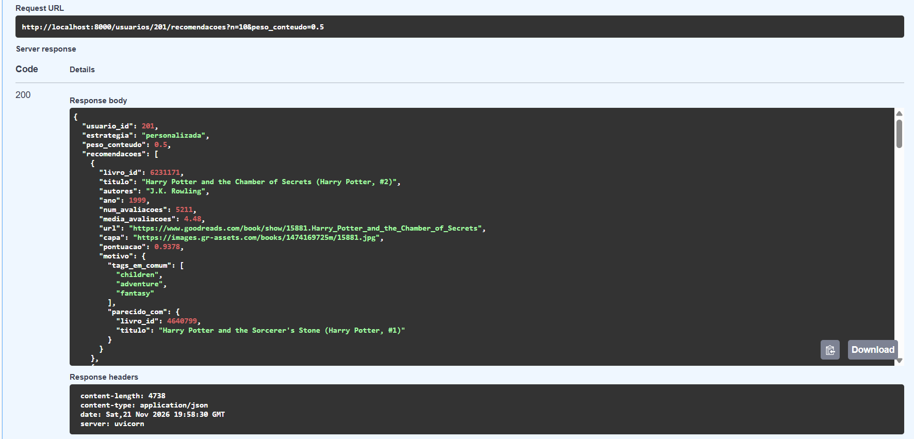

*`GET /usuarios/{usuario_id}/recomendacoes`: livros recomendados com o motivo de cada um.*

### 4. Os dados continuam depois de reiniciar

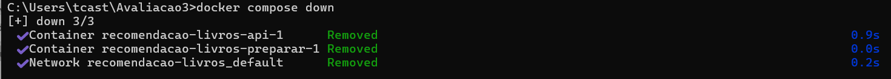

*Depois de `docker compose down` e `docker compose up`: as etapas já feitas são puladas e a API liga em segundos.*

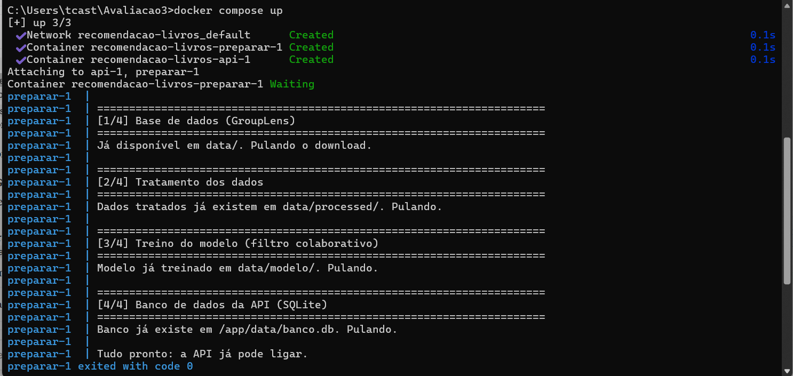

*O usuário criado antes de desligar continua existindo, porque os dados ficam no volume.*

#####

## Como executar sem Docker (manual)

Todos os comandos são rodados no terminal, na pasta raiz do projeto. Os passos 3 a 7 só precisam ser feitos **uma vez**.

1 - Crie e ative o ambiente virtual

```
python -m venv venv
.\venv\Scripts\Activate.ps1
```

* No macOS ou Linux, a ativação é `source venv/bin/activate`.
* Deu certo quando aparecer `(venv)` no começo da linha do terminal.
* No Windows, se aparecer um erro dizendo que a execução de scripts foi desabilitada, rode uma vez `Set-ExecutionPolicy -Scope CurrentUser RemoteSigned` e ative de novo.

2 - Instale as bibliotecas

```
pip install -r requirements.txt
```

3 - Baixe a base de dados (cerca de 1,4 GB)

```
python scripts/baixar_dados.py
```

* Se o download falhar, baixe o `book-genome.zip` pelo navegador no link da base, coloque o arquivo na pasta `data/` e rode o comando de novo. O script percebe o zip e pula o download.

4 - Trate a base (cerca de 20 segundos)

```
python scripts/preparar_dados.py
```

5 - Treine o modelo (cerca de 10 segundos)

```
python scripts/treinar_modelo.py
```

6 - (Opcional) Meça a qualidade do modelo (cerca de 1 minuto)

```
python scripts/avaliar_modelo.py
```

7 - Crie o banco de dados da API (cerca de 10 segundos)

```
python scripts/criar_banco.py
```

8 - Ligue a API

```
uvicorn app.main:app --reload
```

* Deu certo quando aparecer `Application startup complete.`
* O terminal fica ocupado enquanto a API está ligada. Para desligar, aperte `Ctrl + C`.

9 - Abra a documentação interativa (Swagger UI) no navegador

```
http://127.0.0.1:8000/docs
```

#####

## Testes

O projeto tem **246 testes automáticos**, unitários e de integração, feitos com o **pytest**.
Eles rodam em cerca de 5 segundos, **sem internet e sem a base de 1,4 GB**, e não mexem na pasta `data/`.

#### Como rodar

Com o ambiente virtual ativo (passo 1 da seção [Como executar sem Docker](#como-executar-sem-docker-manual)), na pasta raiz do projeto:

1 - Instale as bibliotecas dos testes (uma vez só; já instala junto as do projeto)

```
pip install -r requirements-dev.txt
```

2 - Rode os testes

```
pytest
```

* Deu certo quando a última linha mostrar `243 passed, 3 xfailed`, em verde.
* Para ver o nome de cada teste: `pytest -v`
* Para rodar só um arquivo: `pytest tests/test_api.py`
* Para ver quanto do código os testes cobrem: `pytest --cov=app --cov=scripts --cov=docker --cov-report=term-missing`

Não é preciso rodar os passos 3 a 7 antes: os testes criam os próprios dados.
Testado no Python 3.13 e no 3.14.

#### A base sintética

Usar a base real nos testes seria lento (download de 1,4 GB) e dependeria de internet. Por isso o
`tests/dados_sinteticos.py` monta uma **mini Book Genome falsa**, com os mesmos 4 arquivos e o mesmo formato da original:

* 60 livros em 3 gêneros (fantasia, ficção científica e romance), com 12 tags: 3 fortes em cada gênero e 3 genéricas que todo livro tem um pouco
* 60 usuários, cada um com um gênero favorito: dá nota 4 ou 5 para esse gênero e 1 ou 2 para outro
* Alguns usuários com menos de 5 avaliações, que ficam fora do treino do colaborativo
* Os mesmos problemas da base real, colocados de propósito: livro com ano 0, caractere invisível no título, livro repetido,
  livro sem avaliações, nota 7, avaliação de livro que não existe e avaliação repetida

Com isso, a resposta certa é conhecida: quem gosta de fantasia tem que receber fantasia. Os testes conferem exatamente isso.

Antes de tudo, os testes rodam os scripts de verdade (`preparar_dados.py`, `treinar_modelo.py` e `criar_banco.py`) sobre essa
base, numa pasta temporária. A API é testada com os arquivos gerados por eles, como acontece no Docker.

#### O que é testado

| Arquivo | Tipo | Testes | O que confere |
|---|---|---|---|
| `tests/test_preparar_dados.py` | unitário e integração | 30 | limpeza de texto, ano 0, livro repetido, notas inválidas, avaliação repetida, estatísticas, alinhamento do genome com livros e tags |
| `tests/test_modelo.py` | unitário | 58 | treino do colaborativo, escala de 0 a 1, média bayesiana, perfil de gosto, notas baixas afastando, tags favoritas, motivo da recomendação, livros parecidos, livros novos sem retreino |
| `tests/test_banco.py` | unitário | 25 | criar e buscar usuários, criar e trocar notas, apagar avaliações, transação "tudo ou nada", regra de nota de 1 a 5 no banco, livros novos, persistência no arquivo |
| `tests/test_schemas.py` | unitário | 29 | validações do Pydantic (nota de 1 a 5, nome obrigatório, limite de 20 tags...) e os exemplos que aparecem no Swagger |
| `tests/test_scripts.py` | unitário e integração | 27 | download simulado (sem internet), zip corrompido, falta de espaço em disco, arquivos do treino, banco igual ao CSV, banco existente não é apagado, métrica de acerto do `avaliar_modelo.py` |
| `tests/test_docker_preparar.py` | unitário | 12 | ordem das etapas do serviço `preparar`, etapas já feitas são puladas, falha em qualquer etapa para com erro, banco criado com nome provisório |
| `tests/test_api.py` | integração | 65 | todos os endpoints, códigos de resposta (200, 201, 204, 400, 404, 422), recomendações mudando na hora quando o gosto muda, dados que continuam depois de reiniciar a API, API que não liga sem modelo ou banco e o [roteiro de teste no Swagger](#roteiro-de-teste-no-swagger) de ponta a ponta |

Os testes passam por **99% das linhas** de `app/`, `scripts/` e `docker/` (100% em `app/`). Ficam de fora só 12 linhas,
quase todas mensagens na tela (como a conferência com "Harry Potter" no `treinar_modelo.py`) e as linhas `if __name__ == "__main__"`.

#### Os requisitos do trabalho cobertos pelos testes

* **Adicionar usuários:** `test_criar_usuario_*` (com e sem tags e avaliações, dados inválidos, tags e livros que não existem)
* **Adicionar itens:** `test_criar_livro*`, `test_livro_novo_e_recomendado_na_hora`
* **Obter recomendações:** `test_recomendacao_*`, `test_usuario_novo_sem_nada_recebe_populares`, `test_so_tags_favoritas_ja_personaliza`
* **Atualizar as preferências:** `test_avaliar_livro_e_mudar_a_nota`, `test_atualizar_preferencias*` e `test_recomendacoes_mudam_quando_o_gosto_muda`
* **Documentação no Swagger:** `test_swagger_e_openapi`, `test_exemplos_do_swagger_sao_validos`

#### Os 3 testes "xfail" (falha esperada)

Os testes encontraram um bug no `app/modelo.py`: quando se pedem mais recomendações do que existem livros ainda não avaliados,
os livros que o usuário **já avaliou** voltam no fim da lista, com pontuação `-inf` (que vira `-Infinity` no JSON, um valor inválido).
O mesmo acontece em `populares` com o parâmetro `excluir`.

* Com a base real isso quase nunca acontece: o máximo é 100 recomendações por pedido, então o usuário teria que ter avaliado mais de 9.274 livros.
* Os 3 testes que mostram o bug estão marcados como `xfail` ("falha esperada"). Assim a bateria fica verde e o bug fica registrado.
* A marcação é `strict`: quando o bug for corrigido, o pytest avisa, e é só tirar o `@pytest.mark.xfail`.
* A correção sugerida está no comentário dos testes, em `tests/test_modelo.py`.

#####

## Estrutura do projeto

```
app/
  __init__.py          transforma a pasta app em pacote Python
  modelo.py            modelo de recomendação híbrido
  banco.py             banco de dados SQLite da API
  schemas.py           formatos de entrada e saída da API
  main.py              a API (endpoints do FastAPI)
scripts/
  baixar_dados.py      passo 3: baixa a base e extrai só os arquivos usados
  preparar_dados.py    passo 4: trata a base e gera os arquivos limpos
  treinar_modelo.py    passo 5: calcula os vizinhos do filtro colaborativo
  avaliar_modelo.py    passo 6: mede a taxa de acerto do modelo
  criar_banco.py       passo 7: cria o banco com os usuários e avaliações da base
data/                  fora do Git, gerada pelos scripts
  raw/                 arquivos originais da base (passo 3)
  processed/           arquivos tratados (passo 4)
  modelo/              modelo treinado e resultado da avaliação (passos 5 e 6)
  banco.db             banco de dados da API (passo 7)
tests/
  conftest.py              prepara os dados, o banco e a API para os testes
  dados_sinteticos.py      monta a mini Book Genome falsa usada nos testes
  test_preparar_dados.py   testes do tratamento da base
  test_modelo.py           testes do modelo de recomendação
  test_banco.py            testes do banco de dados
  test_schemas.py          testes das validações de entrada e saída
  test_scripts.py          testes do download, do treino, do banco e da avaliação
  test_docker_preparar.py  testes do serviço preparar do Docker
  test_api.py              testes de integração de todos os endpoints
requirements.txt       bibliotecas do projeto
requirements-dev.txt   bibliotecas dos testes (pytest)
pytest.ini             configuração do pytest
.gitignore             arquivos que não vão para o GitHub
Dockerfile             receita da imagem Docker
docker-compose.yml     serviços preparar e api, e o volume de dados
docker-compose.local-data.yml   opcional: usa a pasta data/ do computador
docker/
  preparar.py          roda os passos 3 a 7 dentro do Docker, pulando o que já foi feito
DOCKER.md              guia detalhado do Docker
docs/evidencias/       prints que mostram o Docker e o sistema funcionando
```

* A pasta `data/` não vai para o GitHub, porque é grande demais. Cada pessoa gera a sua com os passos 3 a 7.
* Cada pessoa tem o próprio banco (`data/banco.db`). Usuários criados num computador não aparecem nos outros.
* Com Docker, a pasta `data/` fica num volume do Docker (veja [Como executar com Docker](#como-executar-com-docker-recomendado)).

#####

## Endpoints da API

Requisitos do trabalho:

* **Adicionar usuários:** `POST /usuarios`
* **Adicionar itens:** `POST /livros`
* **Obter recomendações para um usuário:** `GET /usuarios/{usuario_id}/recomendacoes`
* **Atualizar as preferências de um usuário:**
  * `PUT /usuarios/{usuario_id}/avaliacoes/{livro_id}` avalia um livro ou muda a nota
  * `PUT /usuarios/{usuario_id}/preferencias` troca as tags favoritas

Endpoints extras:

* `GET /` situação da API e totais
* `GET /tags` lista das 727 tags
* `GET /usuarios/{usuario_id}` dados de um usuário
* `GET /usuarios/{usuario_id}/avaliacoes` avaliações de um usuário
* `DELETE /usuarios/{usuario_id}/avaliacoes/{livro_id}` apaga uma avaliação
* `GET /livros/busca?texto=...` busca livros pelo título ou autor
* `GET /livros/populares` livros mais populares
* `GET /livros/{livro_id}` dados, descrição e tags de um livro
* `GET /livros/{livro_id}/parecidos` livros parecidos com um livro

Códigos de resposta:

* `200` deu certo
* `201` criado com sucesso (usuário ou livro novo)
* `204` apagado com sucesso (não tem conteúdo na resposta)
* `400` tag que não existe na base
* `404` usuário, livro ou avaliação não encontrado
* `422` dado inválido (ex.: nota fora de 1 a 5), validado automaticamente pelo FastAPI

#####

## A base de dados

* O zip tem 1,4 GB e não fica no repositório. O `scripts/baixar_dados.py` baixa direto do site da GroupLens e extrai só os 4 arquivos usados:
  * `metadata.json`: título, autores, ano e descrição de 9.374 livros
  * `ratings.json`: 5,1 milhões de avaliações de 1 a 5 estrelas, feitas por 350 mil usuários
  * `tags.json`: os nomes das 727 tags
  * `glmer.csv`: o Tag Genome, ou seja, uma nota de 0 a 1 que diz o quanto cada tag descreve cada livro

* Ficam de fora as 5,3 milhões de resenhas em texto e os arquivos de pesquisa usados para criar o Tag Genome, porque o modelo não usa.

* A análise usa a base inteira. Nenhum livro, usuário ou avaliação é descartado.

#####

## Tratamento dos dados

O `scripts/preparar_dados.py` resolve os problemas encontrados na base:

* 1.256 livros com ano igual a 0 passam a ter o ano como desconhecido
* Caracteres invisíveis são removidos de títulos, autores e descrições
* A coluna de idioma é removida, porque todos os livros são em inglês
* As avaliações são validadas: nota entre 1 e 5, livro existente no catálogo e no máximo uma avaliação por usuário e livro
* Cada livro ganha a quantidade de avaliações e a nota média
* O Tag Genome é reorganizado numa matriz de 9.374 livros x 727 tags

Para rodar em computadores comuns, as avaliações são lidas em pedaços de 500 mil linhas e guardadas em tipos numéricos menores. Isso reduz o uso de memória de cerca de 3,5 GB para cerca de 1 GB, com o mesmo resultado.

Arquivos gerados em `data/processed/`:

* `livros.csv`
* `avaliacoes.csv`
* `tags.csv`
* `genome.npy`
* `resumo.json`

#####

## O modelo de recomendação

O modelo é **híbrido**: faz uma média ponderada entre duas técnicas.

* **Filtragem baseada em conteúdo (Tag Genome)**
  * Cada livro é representado pelas notas das 727 tags.
  * O perfil de gosto do usuário é a soma das tags dos livros que ele avaliou, com peso pela nota: nota 5 vale +2, nota 4 vale +1, nota 3 vale 0, nota 2 vale -1 e nota 1 vale -2.
  * As tags favoritas do usuário também entram no perfil, cada uma com o mesmo peso de um livro nota 5.
  * A pontuação de cada livro é a similaridade do cosseno entre as tags dele e esse perfil.
  * As tags são centralizadas (subtraída a média de cada tag), para o modelo olhar o que é especial em cada livro. Nos testes feitos durante o desenvolvimento, isso mais que dobrou a taxa de acerto do conteúdo (de 3,9% para 8,4%).

* **Filtragem colaborativa item a item**
  * Dois livros são parecidos quando as mesmas pessoas avaliam os dois de forma parecida (similaridade do cosseno entre as notas, centralizadas pela média de cada usuário).
  * Só entram no cálculo usuários com pelo menos 5 avaliações, para reduzir o ruído. Os outros continuam na base e podem receber recomendações.
  * O treino guarda os 50 livros mais parecidos com cada livro. Na recomendação, cada livro avaliado "vota" nos seus vizinhos, com o peso da nota.

* **Híbrido**: as duas pontuações são colocadas na escala de 0 a 1 e somadas com pesos. O peso padrão é 50% conteúdo e 50% colaborativo, e pode ser alterado em cada pedido pelo parâmetro `peso_conteudo`.

* **Usuário sem avaliações e sem tags favoritas**: recebe os livros mais populares, pela média bayesiana (a nota média, "puxada" para a média geral quando o livro tem poucas avaliações).

#####

## Avaliação do modelo

O `scripts/avaliar_modelo.py` usa a técnica de "deixar um de fora":

1 - Sorteia 3.000 usuários.

2 - Esconde um livro que cada um deu nota 5.

3 - Treina o colaborativo de novo sem esses livros, para o modelo não "colar" a resposta.

4 - Verifica se o livro escondido aparece entre as 10 primeiras recomendações.

Taxa de acerto em 10, para usuários com **poucas avaliações** (5 a 10 livros):

* Só popularidade: 2,1%
* Só conteúdo: 9,2%
* Só colaborativo: 13,9%
* Híbrido com 25% de conteúdo: 14,6%
* **Híbrido com 50% de conteúdo: 14,7%**
* Híbrido com 75% de conteúdo: 13,5%

Taxa de acerto em 10, para usuários com **muitas avaliações** (20 livros ou mais):

* Só popularidade: 1,9%
* Só conteúdo: 8,3%
* Só colaborativo: 16,9%
* Híbrido com 25% de conteúdo: 17,1%
* **Híbrido com 50% de conteúdo: 17,1%**
* Híbrido com 75% de conteúdo: 15,0%

Conclusões:

* Escolher 10 livros ao acaso entre 9.374 acertaria só 0,1% das vezes.
* O híbrido com 50% de conteúdo é o melhor nos dois grupos, por isso é o peso padrão.
* O ganho do híbrido é maior para quem tem poucas avaliações, justamente quando o colaborativo tem menos informação.

#####

## Banco de dados da API

A API guarda o que muda num banco **SQLite** (`data/banco.db`): um banco de dados num arquivo só, que já vem com o Python e não precisa de servidor.

* `usuarios`: os 350 mil usuários da base e os criados pela API, com as tags favoritas
* `avaliacoes`: as 5,1 milhões de avaliações da base e as feitas pela API
* `livros_novos`: os livros cadastrados pela API

Detalhes importantes:

* O `scripts/criar_banco.py` cria o banco e copia os usuários e avaliações da base.
* Se o banco já existir, o script não faz nada, para não apagar o que foi criado pela API. Para recriar do zero, apague o `data/banco.db` e rode o script de novo.
* O caminho do banco pode ser trocado pela variável de ambiente `BANCO_PATH`. Sem ela, o caminho é `data/banco.db`.

#####

## Decisões de design

* **Sem retreino a cada usuário novo.** A recomendação é calculada na hora a partir das avaliações e das tags favoritas do usuário. Um usuário novo, uma avaliação nova ou uma nota alterada funcionam imediatamente.

* **O modelo é carregado uma vez só.** Quando a API liga, o modelo vai para a memória. Cada recomendação leva poucos milissegundos.

* **Tags favoritas para o usuário novo.** Escolhendo algumas tags (ex.: "space", "science fiction"), o usuário já recebe recomendações personalizadas antes de avaliar qualquer livro.

* **Livros novos entram pelo conteúdo.** Um livro cadastrado com suas tags já pode ser recomendado na mesma hora, mesmo sem avaliações.

* **Cada recomendação vem com o motivo.** O modelo mostra as tags em comum com o gosto do usuário e o livro avaliado que mais se parece com a recomendação.

* **Usuários da base e da API funcionam igual.** Os dois tipos podem receber recomendações e alterar as avaliações. Os usuários da base têm ids de 0 a 356969 (com alguns números pulados), e os criados pela API recebem os ids seguintes, a partir de 356970.

* **Pensado para computadores comuns.** O treino calcula as similaridades em blocos de 1.000 livros e guarda só os 50 vizinhos de cada um, em vez da tabela completa de 9.374 x 9.374.

#####

## Limitações conhecidas

* **O treino do colaborativo usa só as avaliações da base original.** As avaliações feitas pela API já entram nas recomendações na hora, mas não mudam a lista de "livros parecidos" do colaborativo, porque o `scripts/treinar_modelo.py` lê o `data/processed/avaliacoes.csv`, e não o banco.

* **Livros novos não participam do colaborativo.** Como ainda não têm vizinhos calculados, eles só aparecem pelo conteúdo. Por isso aparecem mais nas recomendações quando o `peso_conteudo` é maior.

* **Os bancos não são compartilhados.** Cada computador tem o próprio `data/banco.db`.

* **Pedindo mais livros do que existem sem avaliar, os já avaliados voltam na lista.** Encontrado pelos testes. Veja
  [Os 3 testes "xfail"](#os-3-testes-xfail-falha-esperada).